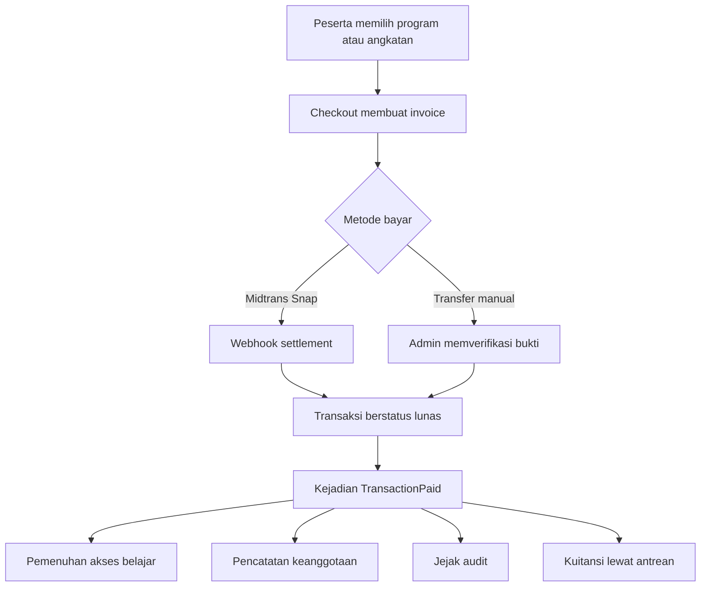
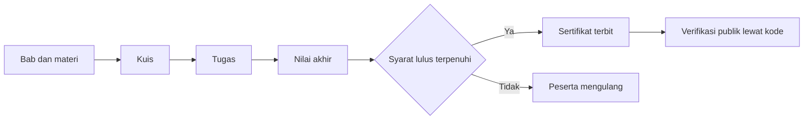
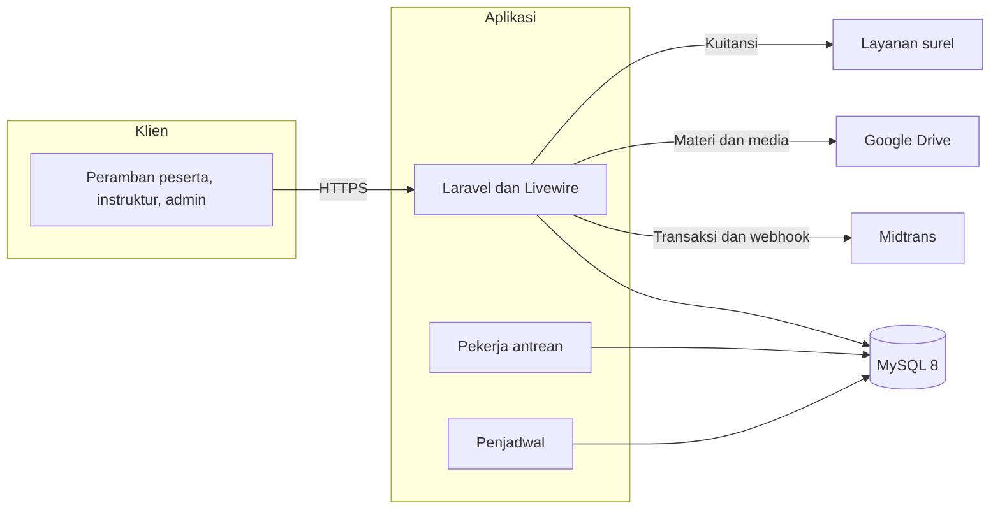

LMS PT LAPI ITB
===============

Platform belajar daring untuk PT LAPI ITB. Sistem ini menangani siklus peserta
dari pendaftaran, pembayaran, pembelajaran, penilaian, sampai penerbitan
sertifikat yang dapat diverifikasi publik.

Repositori ini adalah salinan portofolio dari sistem yang dipakai PT LAPI ITB.
Isinya utuh, mencakup kode aplikasi, migrasi basis data, pengujian otomatis, dan
dokumentasi teknis. README ini ditulis untuk manusia yang ingin menilai produk
dan cara kerja teknisnya dalam beberapa menit.

Gambaran Produk
---------------

PT LAPI ITB menyelenggarakan pelatihan bersertifikat untuk instansi pemerintah,
perusahaan, dan peserta individu. Sebelum sistem ini ada, pendaftaran dilakukan
lewat formulir, pembayaran dikonfirmasi manual lewat pesan, dan progres belajar
tidak tercatat rapi.

Sistem ini menyatukan semuanya dalam satu tempat. Peserta melihat katalog
program, membeli sendiri atau didaftarkan oleh bagian keuangan instansinya,
belajar secara berurutan, mengerjakan kuis dan tugas, lalu mengunduh sertifikat.

Yang membuat sistem ini tidak sekadar katalog kursus adalah aturan aksesnya.
Akses belajar bisa berasal dari pembelian program, dari keanggotaan tahunan,
atau dari kursi korporat yang dibagikan perusahaan. Ketiganya harus tetap
konsisten saat terjadi refund, perpanjangan, pembatalan, atau perubahan angkatan.

Karena itu pemenuhan akses tidak ditempel di controller. Pembayaran dipancarkan
sebagai kejadian domain, lalu beberapa listener bekerja sendiri untuk membuka
akses, mencatat riwayat keanggotaan, menulis jejak audit, dan mengirim kuitansi.

Peran Pengguna
--------------

| Peran | Kebutuhan utama | Yang bisa dilakukan |
|---|---|---|
| Peserta | Mengikuti pelatihan tanpa hambatan administratif | Melihat katalog, membeli program, belajar berurutan, mengerjakan kuis dan tugas, melihat progres, mengunduh sertifikat |
| Instruktur | Menyiapkan kelas dan menilai peserta | Menyusun bab dan materi, menyusun kuis, menilai esai dan tugas, mencatat absensi kelas daring, melihat honor |
| Admin | Menjaga operasional tetap berjalan | Mengelola pengguna, program, angkatan, transaksi, kupon, refund, honor, daftar tunggu, dan sertifikat |
| Publik | Memastikan sertifikat yang diterima asli | Memverifikasi sertifikat lewat kode tanpa perlu masuk |

Alur Bisnis
-----------

Pembelian sampai akses terbuka



Belajar sampai sertifikat



Fitur
-----

| Modul | Isi | Catatan teknis |
|---|---|---|
| Katalog program | Pencarian, filter topik, daftar program dan angkatan | Data program dan angkatan dipisah agar satu program bisa punya banyak angkatan |
| Checkout | Midtrans Snap dan transfer manual | Status transaksi dipisah dari status pemenuhan akses |
| Kupon | Potongan tetap atau persentase dengan batas pemakaian | Kuota kupon dikembalikan saat invoice gagal dibayar |
| Pembelian korporat | Satu pembelian berisi banyak kursi | Kursi dialokasikan ke peserta dan terhubung ke enrollment |
| Daftar tunggu | Antrean saat kuota angkatan penuh | Nomor antrean naik otomatis saat ada kursi kosong |
| Keanggotaan | Paket tahunan dengan masa berlaku | Riwayat pemberian akses dicatat sebagai buku besar yang bisa dibalik |
| Pembelajaran | Bab, materi, urutan wajib | Progres dihitung dari lesson yang benar-benar selesai |
| Kuis | Pilihan ganda, esai, batas percobaan, nilai minimum | Penilaian dijalankan di server, bukan di peramban |
| Tugas | Unggah berkas dengan tenggat | Berkas disimpan di disk privat |
| Penilaian esai | Antrean penilaian untuk instruktur | Nilai nol dianggap nilai sah dan tidak otomatis meluluskan |
| Sertifikat | PDF dengan kode dan kode QR | Halaman verifikasi publik dibatasi laju akses |
| Testimoni | Penilaian materi, instruktur, dan platform | Umpan balik privat dipisah dari testimoni publik |
| Diskusi | Tanya jawab per kelas | Balasan terkait langsung dengan diskusi induk |
| Honor instruktur | Perhitungan dan pencairan honor | Setiap perubahan status tercatat di jejak audit |
| Refund | Pengembalian dana manual | Akses yang sudah terbuka dicabut dan kuota kupon dipulihkan |
| Absensi | Kehadiran kelas daring | Bisa dicatat instruktur atau diimpor admin |
| Operasi angkatan | Kloning angkatan dan pemindahan peserta | Riwayat pendaftaran lama tetap tersimpan |

Arsitektur
----------

Aplikasi dibangun dengan pola TALL, yaitu Tailwind, Alpine, Laravel, dan
Livewire. Halaman interaktif tidak memakai API terpisah. Komponen Livewire
memanggil layanan domain di server, lalu mengirim ulang potongan tampilan yang
berubah.

Aturan bisnis tidak ditulis di komponen tampilan. Aturan bisnis berada di folder
`app/Services`, kejadian domain di `app/Events`, reaksi terhadap kejadian di
`app/Listeners`, dan pemeriksaan izin di `app/Policies`.



| Lapisan | Isi | Tanggung jawab |
|---|---|---|
| Antarmuka | `resources/views`, `app/Livewire` | Menampilkan data dan mengirim aksi pengguna |
| Otorisasi | `app/Policies` | Menentukan siapa boleh membuka atau mengubah konten |
| Layanan domain | `app/Services` | Aturan checkout, kupon, refund, honor, penilaian, sertifikat |
| Kejadian | `app/Events`, `app/Listeners` | Memisahkan pemenuhan akses dari proses pembayaran |
| Data | `app/Models`, `database/migrations` | Relasi tabel dan aturan akses tingkat model |

Keputusan Teknis yang Menarik
-----------------------------

Pemenuhan akses berjalan lewat kejadian. Controller pembayaran hanya mengubah
status transaksi. Setelah itu kejadian `TransactionPaid` memicu listener yang
membuka enrollment, mencatat keanggotaan, menulis jejak audit, dan memasukkan
kuitansi ke antrean surel. Menambah reaksi baru tidak perlu menyentuh controller.

Pemenuhan akses bersifat idempoten. Listener memeriksa apakah akses untuk
transaksi tersebut sudah pernah diberikan. Webhook yang terkirim dua kali tidak
membuat enrollment ganda.

Keanggotaan dicatat sebagai buku besar. Tabel `membership_grants` menyimpan
urutan pemberian akses dan waktu pembalikannya. Saat refund terjadi, hanya
pemberian yang berasal dari transaksi itu yang dibalik, sehingga masa aktif dari
pembelian lain tidak ikut hilang.

Kupon tidak boleh bocor. Saat invoice dibuat, kuota kupon dipesan. Jika invoice
gagal atau kedaluwarsa, pemesanan dilepas kembali. Ada pengujian khusus untuk
skenario ini.

Otorisasi tidak melempar halaman galat secara mendadak. Ketika peserta membuka
konten yang masa aksesnya sudah habis, komponen menampilkan pemberitahuan dan
mengalihkan dengan tenang, bukan menampilkan halaman 403.

Semua kunci utama memakai UUID. Ini memudahkan sinkronisasi data antar layanan
dan mencegah ID berurutan bocor ke URL publik.

Keamanan
--------

- Setiap konten punya policy sendiri, yaitu `CoursePolicy`, `LessonPolicy`, `QuizPolicy`, dan `AssignmentPolicy`.
- Penilaian kuis dihitung di server. Jawaban benar tidak pernah dikirim ke peramban sebelum kuis selesai.
- Masa berlaku akses diperiksa di setiap permintaan, bukan hanya saat membuka halaman kelas.
- Unggahan berkas divalidasi tipe dan ukurannya sebelum disimpan.
- Bukti pembayaran, bukti honor, dan bukti refund disimpan di disk privat dan disajikan lewat rute yang diperiksa izinnya.
- Webhook Midtrans diverifikasi sebelum status transaksi diubah.
- Halaman verifikasi sertifikat publik dibatasi laju akses untuk mencegah penebakan kode.
- Peran dan izin memakai Spatie Permission, dengan pemeriksaan tambahan di level model untuk akses program.

Kinerja
-------

| Metrik | Sebelum | Sesudah |
|---|---|---|
| Waktu tanggap halaman kelas | sekitar 590 ms | 54 sampai 88 ms |
| Query saat membuka pemutar materi | bertambah per lesson | jumlah tetap |
| Navigasi antar halaman | muat ulang penuh | prefetch saat kursor berhenti di tautan |
| Umpan balik saat menunggu | layar diam | indikator loading dan transisi konten |

Perbaikan terbesar datang dari tiga hal. Query berulang di pemutar materi
dihapus dengan memuat relasi yang benar-benar dipakai. Jumlah lesson disimpan
sebagai kolom datar agar tidak dihitung ulang. OPcache diaktifkan di server
sehingga berkas PHP tidak diurai pada setiap permintaan.

Pengujian
---------

Suite terakhir berisi 243 pengujian dengan 866 assertion, semuanya lulus. Isinya
mencakup alur pembayaran, pemenuhan akses, refund, kupon, pembelian korporat,
daftar tunggu, penilaian esai, sertifikat, otorisasi, dan performa query.

Pengujian berjalan di atas basis data khusus yang terpisah dari basis data
pengembangan. Berkas `phpunit.xml` mengarahkan koneksi ke `sbu_test` dan memakai
cache konfigurasi tersendiri agar pengujian tidak pernah menyentuh data asli.

Pemeriksaan gaya kode memakai Laravel Pint. Integrasi berkelanjutan berjalan di
GitHub Actions dengan layanan MySQL 8, menjalankan Pint, seluruh pengujian, dan
build aset frontend.

Teknologi
---------

| Kategori | Pilihan |
|---|---|
| Bahasa dan kerangka kerja | PHP 8.3, Laravel 11 |
| Antarmuka | Livewire 3, Volt, Tailwind CSS 3, Alpine.js, Vite 5, GSAP |
| Basis data | MySQL 8 dengan kunci utama UUID |
| Pembayaran | Midtrans Snap dan transfer manual |
| Media | Spatie Media Library dengan penyimpanan Google Drive |
| Dokumen | barryvdh laravel-dompdf dan Simple QrCode |
| Izin | Spatie Permission |
| Antrean | Laravel Queue dengan driver basis data |
| Pemantauan | Sentry |
| Pengujian | PHPUnit 10, Laravel Pint, GitHub Actions |

Struktur Proyek
---------------

| Folder | Isi |
|---|---|
| `app/Services` | Aturan bisnis dan integrasi pihak ketiga |
| `app/Events` dan `app/Listeners` | Kejadian domain dan reaksinya |
| `app/Models` | Model Eloquent beserta aturan akses |
| `app/Policies` | Pemeriksaan izin per konten |
| `app/Livewire` | Komponen stateful untuk peserta, instruktur, dan admin |
| `resources/views/livewire` | Tampilan komponen per peran |
| `resources/views/layouts` | Tata letak halaman, termasuk pemutar materi dan sertifikat |
| `database/migrations` | Riwayat perubahan skema |
| `tests/Feature` | Pengujian perilaku menyeluruh |
| `docs` | Dokumentasi domain, arsitektur, dan operasional |

Menjalankan di Lokal
--------------------

Prasyarat yang perlu tersedia adalah PHP 8.3, Composer, Node 20, dan MySQL 8.

```powershell
composer install
npm install
copy .env.example .env
php artisan key:generate
php artisan migrate
php artisan db:seed
npm run dev
php artisan queue:work --tries=3
```

Aplikasi dibuka lewat alamat yang sama dengan `APP_URL`. Alamat ini dipakai
Blade untuk menyusun tautan aset, sehingga membuka lewat alamat lain membuat
halaman tampil tanpa gaya.

Untuk mencoba kondisi seperti produksi, jalankan `npm run build` lalu
`php artisan optimize`. Setelah selesai, jalankan `php artisan optimize:clear`
sebelum mengubah konfigurasi lagi.

Variabel lingkungan yang perlu diisi untuk fitur eksternal ada di
`.env.example`. Midtrans, Google Drive, Zoom, dan rekening transfer manual boleh
dibiarkan kosong saat mencoba alur dasar. Fitur terkait akan menampilkan pesan
bahwa konfigurasi belum tersedia, bukan gagal dengan halaman galat.

Data Demo
---------

Ada seeder khusus yang menyiapkan satu program lengkap berisi dua materi, satu
kuis dengan soal pilihan ganda dan esai, satu tugas, satu angkatan terbuka, dan
satu peserta terdaftar.

```powershell
php artisan db:seed --class=PortfolioDemoSeeder
```

Seeder ini aman dijalankan berulang karena memakai kunci alami seperti email,
kode program, kode kelas, dan judul.

| Peran | Email | Kata sandi |
|---|---|---|
| Admin | demo.admin@lapi.test | password |
| Instruktur | demo.instruktur@lapi.test | password |
| Peserta | demo.peserta@lapi.test | password |

Akun bawaan dari `DatabaseSeeder` memakai kata sandi `password` dengan email
`admin@lms.com` untuk admin, `pemateri@lms.com` untuk instruktur, dan
`ridwan@lms.com` untuk peserta.

Catatan dan Batasan
-------------------

Sistem ini sudah dipakai untuk pengembangan dan pengujian internal, tetapi belum
pernah dijalankan di server produksi dengan lalu lintas nyata. Belum ada catatan
hasil uji beban.

Midtrans pada repositori ini masih memakai kredensial sandbox. Rekening transfer
manual sengaja dikosongkan sehingga halaman tagihan menampilkan pesan bahwa
konfigurasi rekening belum tersedia.

Pekerja antrean dan penjadwal belum dijalankan sebagai layanan sistem. Operator
perlu menyiapkan `queue:work` dan `schedule:run` sendiri agar kuitansi terkirim
dan invoice perpanjangan terbentuk tepat waktu.

Livewire masih melakukan perjalanan pulang pergi ke server pada setiap aksi.
Untuk animasi kompleks dan target waktu tanggap di bawah 200 ms, langkah
berikutnya adalah aplikasi hibrida atau soket waktu nyata, bukan menambah tambalan
di sisi klien.

Soal esai dinilai manual oleh instruktur. Ini keputusan produk, bukan kekurangan
teknis.

Dokumentasi
-----------

| Dokumen | Isi |
|---|---|
| [docs/DOMAIN.md](docs/DOMAIN.md) | Entitas bisnis dan aturan akses |
| [docs/ARCHITECTURE.md](docs/ARCHITECTURE.md) | Lapisan aplikasi dan alur permintaan |
| [docs/ERD.md](docs/ERD.md) | Diagram relasi data dan diagram C4 |
| [docs/ENVIRONMENT.md](docs/ENVIRONMENT.md) | Cara menjalankan dan layanan pendukung |
| [docs/TESTING.md](docs/TESTING.md) | Cara menjalankan pengujian |
| [docs/DECISIONS.md](docs/DECISIONS.md) | Catatan keputusan arsitektur |
| [docs/ROADMAP.md](docs/ROADMAP.md) | Rencana kerja per fase |
| [docs/KNOWN_ISSUES.md](docs/KNOWN_ISSUES.md) | Temuan yang masih terbuka |
| [docs/PHASE2.md](docs/PHASE2.md) | Rekap fitur operasional |
| [docs/PHASE3.md](docs/PHASE3.md) | Rekap perbaikan performa dan pengalaman pengguna |

Lisensi dan Kepemilikan
-----------------------

Kode dan data milik PT LAPI ITB. Repositori ini dipublikasikan sebagai
portofolio teknis. Hak cipta tetap pada PT LAPI ITB dan tidak ada lisensi
penggunaan komersial yang diberikan.

Jangan menyebarkan berkas `.env`, kredensial layanan, atau cadangan basis data ke
repositori publik.
