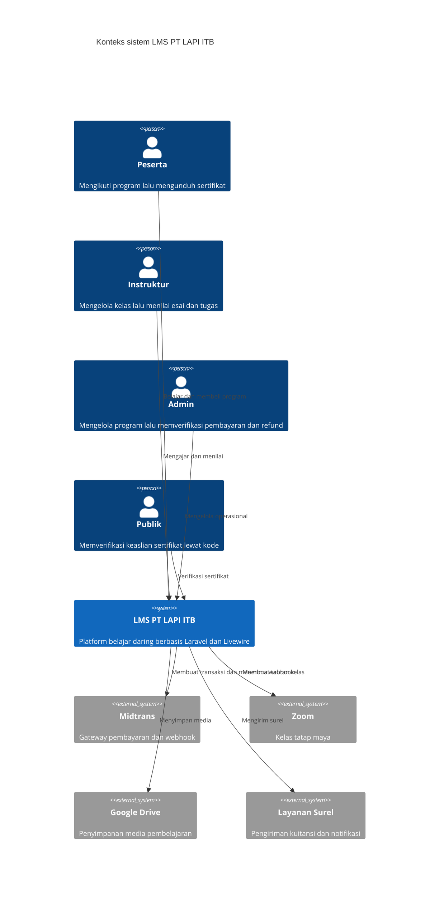
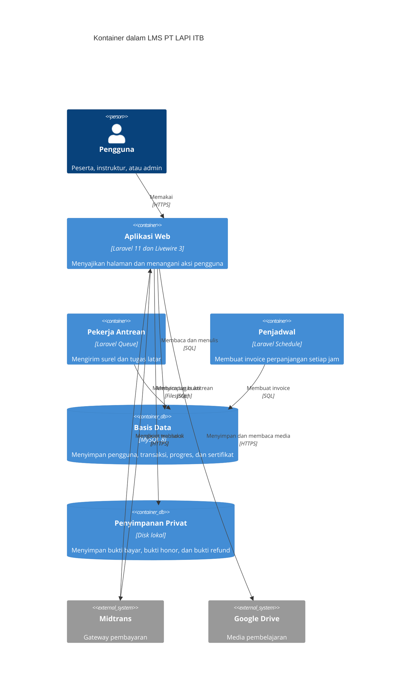
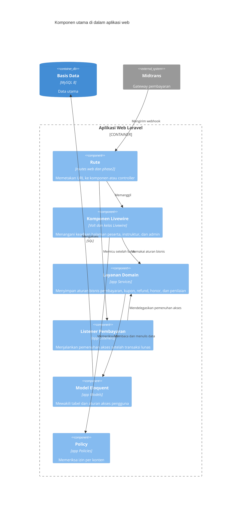
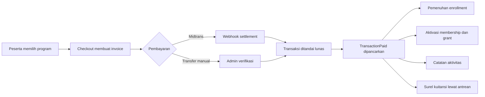

Diagram Sistem LMS PT LAPI ITB
==============================

Dokumen ini memuat ERD dan diagram C4. Semua nama tabel diambil langsung dari
skema database, bukan rekaan. Diagram ditulis dengan Mermaid sehingga bisa
dirender di GitHub, GitLab, maupun VS Code.

ERD Utama
---------

```mermaid
erDiagram
    users ||--o| user_profiles : memiliki
    users ||--o{ enrollments : mendaftar
    users ||--o{ transactions : membayar
    users ||--o{ certificates : menerima
    users ||--o{ quiz_attempts : mengerjakan
    users ||--o{ course_testimonials : menilai
    users }o--o| membership_plans : berlangganan

    programs ||--o{ batches : memiliki
    programs ||--o{ transactions : dijual
    programs }o--o{ courses : program_courses
    programs ||--o{ corporate_purchases : dibeli_korporat

    courses ||--o{ sections : memiliki
    courses ||--o{ materials : berisi
    courses ||--o{ quizzes : berisi
    courses ||--o{ assignments : berisi
    courses ||--o{ certificates : menerbitkan
    courses ||--o{ discussions : berisi

    sections ||--o{ lessons : memiliki
    lessons }o--o| materials : menampilkan
    lessons }o--o| quizzes : menampilkan
    lessons }o--o| assignments : menampilkan

    quizzes ||--o{ questions : memiliki
    questions ||--o{ question_options : memiliki
    quizzes ||--o{ quiz_attempts : dicatat
    quiz_attempts ||--o{ quiz_answers : berisi

    assignments ||--o{ submissions : dikumpulkan

    transactions ||--o{ enrollment_payment_sources : mencatat
    enrollments ||--o{ enrollment_payment_sources : dicatat
    transactions ||--o| refunds : dikembalikan
    transactions ||--o| subscriptions : memperpanjang
    subscriptions ||--o{ membership_grants : mencatat
    transactions ||--o| coupons : memakai_kupon
    coupons ||--o{ coupon_redemptions : dipakai
    transactions ||--o| corporate_purchases : menagih
    corporate_purchases ||--o{ corporate_seats : mengalokasikan

    batches ||--o{ batch_waitlists : mengantre
    batches ||--o{ live_attendances : mencatat_hadir
    batches ||--o{ payouts : membayar_honor
    payouts ||--o{ payout_audits : diaudit

    discussions ||--o{ discussion_replies : dibalas

    users {
        char id PK
        string name
        string email
        string password
        boolean is_active
        char membership_plan_id FK
        timestamp membership_expires_at
    }

    user_profiles {
        char user_id PK
        string full_name
        string nik
        string phone_number
        string agency_name
        string position
        string gender
    }

    programs {
        char id PK
        string title
        string enrollment_code
        decimal price
        string type
        string min_membership_level
        boolean is_active
        string status
    }

    courses {
        char id PK
        string title
        string course_code
        string status
        boolean is_sequential
        char instructor_id FK
    }

    sections {
        char id PK
        char course_id FK
        string title
        int order_index
    }

    lessons {
        char id PK
        char section_id FK
        int sort_order
        string item_type
        char material_id FK
        char quiz_id FK
        char assignment_id FK
    }

    materials {
        char id PK
        char course_id FK
        string title
        string type
        string status
    }

    quizzes {
        char id PK
        char course_id FK
        string title
        int passing_grade
        int max_attempts
    }

    questions {
        char id PK
        char quiz_id FK
        string question_type
        int score_weight
    }

    quiz_attempts {
        char id PK
        char quiz_id FK
        char user_id FK
        decimal score
        timestamp submitted_at
        timestamp graded_at
    }

    quiz_answers {
        char id PK
        char quiz_attempt_id FK
        char question_id FK
        decimal score
        text instructor_feedback
    }

    assignments {
        char id PK
        char course_id FK
        string title
        int deadline_days
    }

    submissions {
        char id PK
        char assignment_id FK
        char user_id FK
        decimal grade
    }

    enrollments {
        char id PK
        char user_id FK
        string enrollable_type
        char enrollable_id
        string status
        timestamp access_expires_at
    }

    transactions {
        char id PK
        string invoice_code
        char user_id FK
        char program_id FK
        char batch_id FK
        char membership_plan_id FK
        decimal amount
        string payment_status
        timestamp paid_at
        timestamp refunded_at
    }

    membership_plans {
        char id PK
        string level
        string billing_period
        decimal price
        boolean is_active
    }

    subscriptions {
        char id PK
        char user_id FK
        char membership_plan_id FK
        string status
        timestamp next_billing_at
    }

    membership_grants {
        char id PK
        char transaction_id FK
        char user_id FK
        int grant_order
        timestamp granted_until
        timestamp reversed_at
    }

    certificates {
        char id PK
        char user_id FK
        char course_id FK
        char batch_id FK
        string certificate_code
        timestamp issued_at
    }

    batches {
        char id PK
        char program_id FK
        char course_id FK
        int quota
        string status
    }

    batch_waitlists {
        char id PK
        char batch_id FK
        char user_id FK
        int queue_number
        string status
    }

    live_attendances {
        char id PK
        char batch_id FK
        char material_id FK
        char user_id FK
        string status
    }

    payouts {
        char id PK
        char batch_id FK
        char instructor_user_id FK
        decimal amount
        string status
    }

    payout_audits {
        char id PK
        char payout_id FK
        char actor_id FK
        string action
    }

    coupons {
        char id PK
        string code
        string discount_type
        decimal discount_value
        int max_uses
    }

    coupon_redemptions {
        char id PK
        char coupon_id FK
        char transaction_id FK
        string status
    }

    corporate_purchases {
        char id PK
        string company_name
        char buyer_user_id FK
        char program_id FK
        int seat_count
        string status
    }

    corporate_seats {
        char id PK
        char corporate_purchase_id FK
        char user_id FK
        char enrollment_id FK
    }

    enrollment_payment_sources {
        char id PK
        char transaction_id FK
        char enrollment_id FK
        boolean preserves_existing_access
        timestamp reversed_at
    }

    refunds {
        char id PK
        char transaction_id FK
        decimal amount
        string reason
    }

    course_testimonials {
        char id PK
        char user_id FK
        char course_id FK
        string status
    }

    discussions {
        char id PK
        char course_id FK
        char user_id FK
    }

    discussion_replies {
        char id PK
        char discussion_id FK
        char user_id FK
    }
```

C4 Level 1 Konteks
------------------

C4 Level 2 Kontainer
--------------------

C4 Level 3 Komponen Aplikasi Web
--------------------------------

Alur Pembayaran Ringkas
-----------------------

